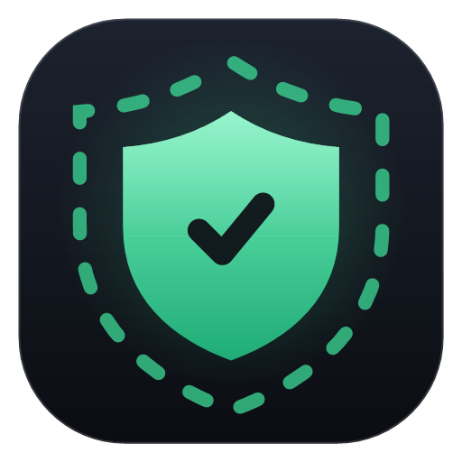

# Border Control

A compact Windows 11 tray app that watches for VPN connections and keeps your PC from giving away your real location: it matches the time zone, region and keyboard to the VPN, turns off Windows location, closes chosen apps if the VPN drops, and checks for IP, DNS, IPv6 and WebRTC leaks.

**Download:** the latest `BorderControl.exe` is on the [Releases](../../releases/latest) page. It needs the .NET 8 Desktop Runtime and asks for administrator rights. From 2.1.0 on, the app updates itself.

## Versions

Each version lives in its own folder so older builds stay available:

| Folder | Notes |
|---|---|
| [`v2.2.0`](v2.2.0) | Current – settings, kill switch, stealth options, WebRTC and visibility checks, flags |
| [`v2.1.0`](v2.1.0) | DNS route check, explained results with notes, auto-update |
| [`v2.0.0`](v2.0.0) | First Border Control release |

See the README inside each folder for details and build steps.
