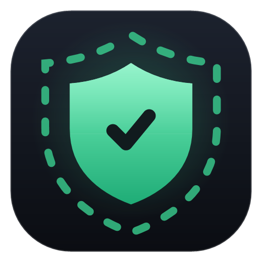

# Border Control

A compact Windows 11 tray app that watches for VPN connections and keeps your PC from giving away your real location: it matches the time zone to the VPN, turns off Windows location, adds the VPN country's keyboard, and checks for IP, DNS and IPv6 leaks.

**Download:** the latest `BorderControl.exe` is on the [Releases](../../releases/latest) page. It needs the .NET 8 Desktop Runtime and asks for administrator rights. From 2.1.0 on, the app updates itself.

## Versions

Each version lives in its own folder so older builds stay available:

| Folder | Notes |
|---|---|
| [`v2.1.0`](v2.1.0) | Current – DNS route check, explained results with notes, auto-update |
| [`v2.0.0`](v2.0.0) | First Border Control release |

See the README inside each folder for details and build steps.
