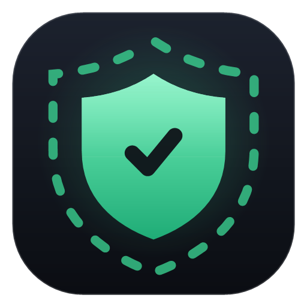

# Border Control



A compact Windows 11 tray app that watches for VPN connections and keeps your system from leaking your real location.

## What it does

- **VPN detection** – asks Windows which adapter carries internet traffic. If it is a virtual adapter (WireGuard/Wintun, OpenVPN/TAP, PPP/IKEv2, or the TUN adapter of v2ray/xray/sing-box clients such as Happ, Hiddify, Clash, v2rayN), the VPN counts as connected. Idle VPN adapters that carry nothing are ignored. With no tunnel, an enabled system proxy counts as "proxy mode" (shown as a warning, since apps that ignore the proxy bypass it). Reacts to network-change events and re-checks every 10 s.
- **Time zone sync** – on connect, looks up the VPN exit IP, maps its IANA zone to a Windows zone and applies it with `tzutil`. On disconnect (or app exit / sign-out) your real zone is restored. The original zone is saved in `%AppData%\BorderControl\state.json`, so it is also restored after a crash.
- **Location off** – while a VPN is connected, the Windows location service is switched off; your previous setting comes back on disconnect.
- **VPN country keyboard** – adds the keyboard for the VPN country (e.g. German for DE) while connected and removes it afterwards. Keyboards you already had are never touched.
- **DNS leak test, two ways** – a *route check* asks Windows which adapter each configured DNS server is reached through and probes any server outside the tunnel (an answer means a real leak path); a *resolver test* (bash.ws) checks which DNS servers actually answer your lookups. The worse result wins.
- **Clear results** – click any check for its results as tidy rows plus a "What this means" note: whether it's fine, what a site or your provider could learn, and what to do. Copy any result with one click.
- **Auto-update** – checks GitHub releases at start and every 6 hours, downloads new versions in the background, verifies the SHA-256 and offers a one-click restart. Your current settings carry over.
- **Leak checks** – public IP vs. your real IP, DNS resolver test, IPv6 test, time zone match, Windows region/language/keyboards, and the Windows location service.
- **Two clocks** – your real local time and the system time apps currently see.
- **UI** – compact Mica window with a live status ring, ambient light tinted by status, pastel badges per check and an Activity sheet. Respects Windows "Animation effects" (fades only when off).
- **Tray icon** – shield that turns green / amber / red / grey (✓ ! ✕ –), with a menu and toast notifications for connect, disconnect, time zone changes and leaks.

## Version folders

Each version lives in its own folder (`v2.0.0`, `v2.1.0`, …) so older builds stay available.

## Build and run

Requires the .NET 8 SDK on Windows 11.

```
dotnet build -c Release
dotnet run -c Release
```

Single-file publish:

```
dotnet publish -c Release -r win-x64 --self-contained false -p:PublishSingleFile=true
```

The app asks for administrator rights (needed to change the time zone). Start minimised to the tray with `BorderControl.exe --tray`.

## Status colours

| Colour | Meaning |
|---|---|
| Green | VPN up, no leaks found |
| Amber | VPN up, but a warning (e.g. region mismatch, location service on) |
| Red | Leak detected (real IP, DNS or IPv6 exposed) |
| Grey | No VPN connected |

## Known limits

- Every change (time zone, location, keyboard) is recorded before it is made and undone on disconnect, exit, sign-out or the next start after a crash.
- The system time zone is global: every app, your calendar and file timestamps follow it while a VPN is connected.
- Apps that are already running may keep the old zone until restarted.
- "Real IP" is learned the last time no VPN was active. If you start the app with the VPN already on, leak comparisons are weaker until the first disconnect.
- Proxy mode only protects apps that honour the Windows system proxy; use the client's TUN mode for full coverage.
- Leak tests use public services (ipwho.is, ipapi.co, api6.ipify.org, bash.ws).
- No kill switch yet. A good next step is blocking non-VPN traffic with Windows Firewall rules when the tunnel drops.
